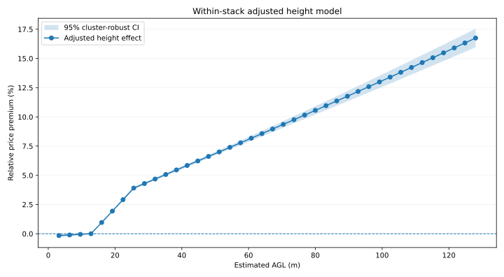
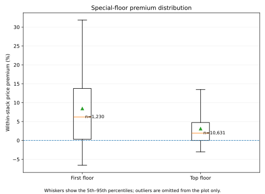

# Floor Premium Curve

研究台灣集合住宅「垂直高度」對成交單價的影響。核心目標是估計：在盡量固定建案、戶別與成交時間後，住宅地板離地高度（AGL, Above Ground Level）對市場價格的邊際影響。

## Full-history result

目前主結果使用內政部實價登錄預售屋歷史資料，來源發布期涵蓋 **2021 Q3–2026 Q3**，並合併 **2026-10-28** 最新 Open Data 批次。資料以實價登錄「建案名稱 + 棟及號」辨識同一垂直戶別 stack，再做 stack 內比較。



圖中的 Y 軸以 **5F ≈ 12.8 m** 為 0% 基準，曲線已控制：

- 同一垂直戶別 stack fixed effect
- 交易月份 fixed effects（102 個月份）
- 1F 特殊效果
- 頂樓特殊效果
- 高度的 piecewise linear spline

模型：

```text
log(price)
  = stack_fixed_effect
  + transaction_month_fixed_effect
  + spline(height_agl)
  + first_floor
  + top_floor
  + error
```

標準誤以 stack 為 cluster 計算。

### 主要高度溢價

| 樓層 | 估計 AGL | 相對 5F 價格 | 95% CI |
| ---: | ---: | ---: | ---: |
| 2F | 3.2 m | -1.22% | -1.33% ~ -1.10% |
| 3F | 6.4 m | -0.81% | -0.89% ~ -0.74% |
| 4F | 9.6 m | -0.41% | -0.45% ~ -0.37% |
| 5F | 12.8 m | 0.00% | reference |
| 6F | 16.0 m | +0.83% | +0.81% ~ +0.85% |
| 8F | 22.4 m | +2.52% | +2.45% ~ +2.58% |
| 10F | 28.8 m | +3.64% | +3.56% ~ +3.72% |
| 15F | 44.8 m | +5.16% | +5.05% ~ +5.26% |
| 20F | 60.8 m | +6.94% | +6.78% ~ +7.09% |
| 30F | 92.8 m | +10.58% | +10.24% ~ +10.92% |
| 40F | 124.8 m | +14.35% | +13.81% ~ +14.90% |

目前 pooled 結果呈現相當穩定的高度溢價：低於約 5F 有小幅折價，5F 以上隨高度增加而上升。曲線在 9F 左右斜率開始變緩，但仍維持正向。

## 1F 與頂樓

1F 與頂樓不直接混進一般高度曲線，而是另外放 dummy，以免庭院、露台、挑高、屋頂熱負荷等特殊屬性被錯算成純高度效果。

| 特殊樓層 | n | Height-adjusted estimate | 95% CI |
| --- | ---: | ---: | ---: |
| 1F | 1,230 | **+10.02%** | +9.38% ~ +10.67% |
| 頂樓 | 10,631 | **-0.19%** | -0.28% ~ -0.09% |

1F 的 +10% 不應解讀成「離地 0m 本身值 +10%」。它代表在模型扣除一般高度曲線後，實價登錄中 1F 住宅仍存在顯著的特殊戶別溢價；可能包含庭院、獨立出入口、特殊坪效等因素。頂樓則在扣除高度後呈現非常小的負向特殊效果。

## 資料規模

| 階段 | 數量 |
| --- | ---: |
| 來源 CSV | 436 |
| 原始來源列 | 452,697 |
| 去重後 | 452,236 |
| 有效集合住宅 | 369,991 |
| 可辨識同一 stack | 163,211 |
| Comparable stacks | **16,609** |
| 模型觀測值 | **155,984** |
| 一般樓層觀測值 | 144,123 |
| 1F | 1,230 |
| 頂樓 | 10,631 |

資料品質處理：

- 461 筆跨批次重複資料已依實價登錄編號去重。
- 19 個歷史 CSV 有舊格式列寬問題，共修復 32 列。
- 436 個來源檔中有 2 個 2021 Q4 舊檔無法可靠解析，因此明確跳過並記錄；約占來源檔 **0.46%**。
- 完整來源 metadata 位於 `data/processed/full_history_source_metadata.json`。

## 代表性怎麼看

目前資料量已經足以做穩定的 pooled 統計估計，和早期只有數十筆 comparable observations 的 pilot 有本質上的差異。模型涵蓋 16,609 個垂直戶別 stack、15.6 萬筆可比較成交，而且控制交易月份，因此「高度溢價存在」這個訊號目前具有相當強的統計支持。

但它仍應被稱為：

> **台灣預售屋市場的高度價格溢價曲線**

而不是直接稱為「所有台灣住宅使用者的真實偏好曲線」。

主要限制：

1. **預售屋 selection**：目前主分析以預售屋為主，未必完全代表中古屋買方。
2. **Stack selection**：只有「建案名稱 / 棟及號」能可靠辨識同垂直戶別的交易會進嚴格比較。
3. **交易市場權重**：成交較多的建案與地區自然有較高權重，代表的是實際交易市場組成。
4. **AGL 是估計值**：目前用 `(floor - 1) × 3.2m`，尚未取得每棟建物實際樓高。
5. **未觀測特殊屬性**：景觀遮蔽、棟距、露台、朝向等資訊並不完整。
6. **模型形式**：95% CI 反映抽樣／估計不確定性，不包含 spline knot、樓高假設等 specification risk。

下一步最有價值的是做 **區域分層與 robustness checks**：例如北北桃、中彰投、台南、高雄分別估計曲線，以及比較不同 spline knots、樓高假設與 equal-stack weighting，確認目前全台 pooled 曲線不是被少數高交易量區域帶動。

## Descriptive curve

除了 adjusted model，也保留較少模型假設的 descriptive 結果：每筆成交先除以同 stack 的中位單價，再依樓層聚合。主圖現在**只畫一般樓層**，避免 1F 的極端分布把 Y 軸壓縮。


### 特殊樓層分布

1F 與頂樓另外畫成 box plot。這張圖呈現的是尚未扣除高度模型的 within-stack premium 分布；whisker 為第 5–95 百分位，極端值仍保留在資料中，只是不畫在圖上。



對應檔案：

- `data/processed/full_curve.csv`
- `data/processed/full_special_floors.csv`
- `data/processed/full_model_curve.csv`
- `data/processed/full_model_special_effects.csv`
- `results/full_curve.svg`
- `results/full_special_floors.svg`
- `results/full_model_curve.svg`
- `results/full_summary.md`

完整逐筆 comparable observations 因檔案較大，由 GitHub Actions 以 artifact 保留，不直接提交 Git。

## 資料來源

正式資料源使用內政部不動產交易實價查詢服務網 Open Data：

- 預售屋最新批次：`https://plvr.land.moi.gov.tw/opendata/lvr_landBcsv.zip`
- 歷史季度批次：內政部 `DownloadSeason` endpoint
- 政府資料開放平臺：
  - https://data.gov.tw/dataset/25119
  - https://data.gov.tw/dataset/6215

目前歷史下載範圍設定為民國 110S3 起；截至本次分析，115S3 可取得，115S4 尚未發布可用 ZIP。

## 執行

```bash
python -m venv .venv
source .venv/bin/activate
pip install -e ".[dev]"

# 最新批次
python scripts/download_latest.py --kind presale

# 歷史季度資料
python scripts/download_history.py --start-season 110S3 --output-dir data/raw/history

# 完整分析
python scripts/run_analysis.py \
  --input-dir data/raw \
  --kind presale \
  --output data/processed/full_curve.csv \
  --observations data/processed/full_observations.csv \
  --special-floors data/processed/full_special_floors.csv \
  --model-effects data/processed/full_model_special_effects.csv \
  --model-curve data/processed/full_model_curve.csv \
  --plot results/full_curve.svg \
  --special-plot results/full_special_floors.svg \
  --model-plot results/full_model_curve.svg \
  --summary results/full_summary.md
```

測試：

```bash
pytest
```

## Pilot

`data/pilot/AllPreData.csv` 與 `results/pilot_*.svg` 保留最早期的小樣本方法驗證，方便比較研究從 1,200 筆 snapshot 演進到 full-history pipeline 的過程；目前正式解讀應以 `full_*` 結果為主。
